  

### Sobre

Estudante de **Desenvolvimento de Software Multiplataforma** (FATEC) e técnico em **Desenvolvimento de Sistemas** (ETEC).  
Foco em **Desenvolvimento Web, Automação e TI** — construindo soluções práticas para problemas reais.

---

### Stack

  

`Power BI` · `TOTVS` · `Power Apps` · `Docker` · `AWS EC2`

---

### Projetos em Destaque

| Projeto | Descrição | Stack |
| :--- | :--- | :--- |
| **AdaptIA** *(privado)* | Plataforma web inclusiva com IA para adaptação de atividades pedagógicas (PEI/PAEE) | `Node.js` · `Express` · `Gemini API` · `Docker` |
| [**Recebimento PWA**](https://github.com/marcoserculianipw/conferencia-recebimento) | Controle digital e conferência de recebimento logístico | `TypeScript` · `PWA` |
| [**Painel de Automação Desktop**](https://github.com/marcoserculianipw/painel-de-automacao-desktop) | Automação nativa de rotinas diárias de trabalho em 1 clique com UI Fluent | `PowerShell` · `WPF` |
| [**Naildesign**](https://github.com/marcoserculianipw/naildesign) | Site multipágina evoluído com backend de agendamentos | `Python` · `Flask` · `MySQL` |
| **FNCASH** | Sistema de gestão financeira pessoal | `PHP` · `MySQL` |

---

### Experiência

- **Positivo S.A.** — Automação & TI
- **Intercarta** — Jovem Aprendiz em Logística Administrativa (`Power BI` · `TOTVS` · `PWA`)

---

  
  

